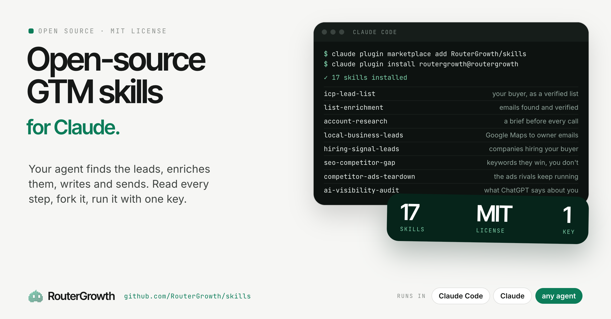
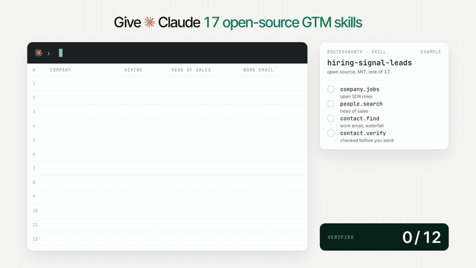

<p align="center">
  
</p>

# Open-source GTM skills for Claude, Codex, Cursor and any agent

[](https://github.com/RouterGrowth/skills/actions/workflows/validate.yml) [](LICENSE) [](#the-skills) [](CHANGELOG.md)

**Your agent builds the lead list, finds and verifies the emails, researches the account, maps the competition and drafts the message, on live data.** Seventeen skills that turn the [RouterGrowth](https://www.routergrowth.com) connector (people and companies, work emails and phones across several data providers, hiring and funding signals, Google Maps, SEO, AI answers, social, ads) into finished GTM jobs. Pay per call from one balance, no subscription.

```bash
# Claude Code: skills + the connector in one plugin
claude plugin marketplace add RouterGrowth/skills
claude plugin install routergrowth@routergrowth

# Any other agent (Codex, Cursor, Gemini CLI, Copilot, OpenCode, Windsurf, Goose...)
npx skills add RouterGrowth/skills
```

Then sign in once: in Claude Code run `/mcp` and approve a workspace. In other agents, add the remote MCP server `https://api.routergrowth.com/mcp/claude` (OAuth). Per-agent steps: [routergrowth.com/docs/quickstart-mcp](https://www.routergrowth.com/docs/quickstart-mcp). New workspaces start with free credit.

<p align="center"></p>

## The skills

**Find leads**

| Skill | What you get | Say |
| --- | --- | --- |
| [icp-lead-list](skills/icp-lead-list) | Your buyer description turned into a scored list of people at matching companies, verified emails, one line on why each fits | "build me a lead list", "find heads of growth at Series A SaaS in Europe" |
| [hiring-signal-leads](skills/hiring-signal-leads) | Companies hiring for the role you sell to, the buyer at each, a verified email, a first email sent after your approval | "who is hiring SDRs", "turn job postings into accounts" |
| [local-business-leads](skills/local-business-leads) | Local businesses from Google Maps by category and city, the owner, a verified email, one pain point from their reviews | "dentists in Lisbon", "Google Maps leads", "gyms without a website" |
| [social-lead-discovery](skills/social-lead-discovery) | Leads from X, Instagram, TikTok and YouTube: who posts about the topic, who asks under a competitor's post, their site and contact | "people complaining about X on Twitter", "who comments under this post" |

**Enrich**

| Skill | What you get | Say |
| --- | --- | --- |
| [list-enrichment](skills/list-enrichment) | Your CSV back with domains fixed, work emails found across several providers, every address verified, phones on request, misses explained | "enrich this list", "find emails for these people", "verify these emails" |

**Research**

| Skill | What you get | Say |
| --- | --- | --- |
| [account-research](skills/account-research) | A one-page brief before a call: what the company sells, what changed lately, who decides, three angles, every fact sourced | "prep me for a call with acme.com", "research this company" |
| [competitor-ads-teardown](skills/competitor-ads-teardown) | Competitors' live Meta and Google ads, how long each has run, the angles and offers that repeat, the gaps, text briefs for yours | "what ads is X running", "competitor ad research" |
| [seo-competitor-gap](skills/seo-competitor-gap) | The keywords competitors rank for and you do not, sized and sorted into a plan of pages to write or fix | "keyword gap", "why do they outrank us" |
| [ai-visibility-audit](skills/ai-visibility-audit) | A frozen panel of buyer questions across ChatGPT, Claude, Gemini and Perplexity: mentions, citations, share of voice | "what does ChatGPT say about us", "AEO audit" |
| [reddit-surface-map](skills/reddit-surface-map) | The Reddit threads ranking for your money queries, the subreddits behind them, their rules on vendors | "which subreddits matter for us" |
| [brand-mention-sweep](skills/brand-mention-sweep) | Every mention of the brand, founder and competitors in 90 days, with sentiment and the threads worth a reply | "who is talking about us", "brand monitoring" |

**Messaging** (email sent only after you approve each message; LinkedIn, Instagram and WhatsApp stay drafts)

| Skill | What you get | Say |
| --- | --- | --- |
| [email-list-pipeline](skills/email-list-pipeline) | Research, list, grade, verify, write, then send by email after approval, from a directives folder with your ICP and copy rules | "build a list and write the emails" |
| [intent-messaging](skills/intent-messaging) | From an intent signal to a plan per person: LinkedIn drafts and an approved email follow-up | "find intent leads and write what to say" |
| [linkedin-drafts](skills/linkedin-drafts) | The profiles you pick read, a connection note and first message drafted for each, answers to replies drafted | "draft notes for these profiles", "who replied on LinkedIn" |
| [sdr-daily](skills/sdr-daily) | One day of the loop: replies triaged, suppressions kept, follow-ups due written, approved emails sent, a briefing | "run the SDR", "what's due today" |
| [community-help-drafts](skills/community-help-drafts) | The Reddit and X threads where an honest answer is welcome, drafted for you to post | "where should I be answering questions" |

**Core**: [routergrowth](skills/routergrowth) carries the connector's tools, the spending rules and the privacy rules every skill builds on.

Each skill has `evals/evals.json`: the prompts that should and should not trigger it, and what a good run must do.

## How it works

1. **Connect.** The plugin registers the RouterGrowth connector at `https://api.routergrowth.com/mcp/claude`. The first time, your agent asks you to sign in to RouterGrowth (OAuth) and approve a workspace.
2. **Ask.** A skill loads when your request matches it and tells the agent which tools to call, in what order, with which checks and human gates.
3. **Pay per result.** The agent reads each tool's price before its first call and asks before a job likely above about $1. Lookups (emails, phones, profiles, company data) try several data providers in turn and are charged only for the one that finds; failed calls cost nothing. Every paid call returns a receipt, and `list_runs` reads them back for free.
4. **Keep the work.** With workspace tables on, lists persist between conversations and the do-not-contact list applies to every session.

## Install anywhere

| Where | How |
| --- | --- |
| Claude Code | `claude plugin marketplace add RouterGrowth/skills`, then `claude plugin install routergrowth@routergrowth`, then `/mcp` to sign in |
| Claude apps and Cowork | Add RouterGrowth from the connector directory, or upload one skill's ZIP from the [latest release](https://github.com/RouterGrowth/skills/releases/latest) under Settings, Capabilities, Skills |
| Codex, Cursor, Gemini CLI | Native manifests ship in this repo (`.codex-plugin`, `.cursor-plugin`, `gemini-extension.json`), each wiring the connector |
| Any agent that reads skills | `npx skills add RouterGrowth/skills`, then add the MCP server `https://api.routergrowth.com/mcp/claude` |
| By hand | Copy a folder from `skills/` into your agent's skills directory (for Claude Code, `~/.claude/skills/`) |

Prices come from `get_operation_pricing` at run time, never from this repo.

## Messaging

The messaging skills write to people who have a reason to hear from you: customers, inbound leads, event attendees, people who engaged with your content, introductions, or a business contact where you have a legitimate reason and the law allows it.

- **Email** goes out from your RouterGrowth inbox or your Gmail, only after you approve each message exactly as shown (from, to, subject, body), one at a time at the daily pace you set. Suppressed people, people who opted out with RouterGrowth and people already written to recently are blocked by the server, in every workspace.
- **LinkedIn, Instagram and WhatsApp** go out from your personal logins, so the skills keep them as drafts you send yourself. The core skill can send a single message there to someone who already knows you, after you approve it. No connection requests, no sequences.
- Nothing here posts, comments, follows or automates engagement on a platform, and no skill connects an account or sets up a sending domain on its own.

## What this plugin connects to and sends

- **One remote MCP server:** `https://api.routergrowth.com/mcp/claude`, declared in `.mcp.json`, reached over OAuth. When Claude calls one of its tools, the tool's inputs (a domain, a name, a search phrase, an email you approved) go to RouterGrowth, which forwards them to the data provider that serves the call and returns the result to Claude.
- **Nothing else.** The plugin has no hooks, commands, binaries or packages that run on your machine (`scripts/check_skills.py` is a CI check for contributors, never run by the plugin), sends no telemetry and fetches no instructions at run time: everything Claude follows is in the `SKILL.md` files here.
- **Feedback only on request.** The connector has a `submit_feedback` tool that sends a bug report to the RouterGrowth team. The skills call it only when you ask, or after offering and getting your yes, and never include personal data in it.

## Contact data and privacy

- **Sources:** work emails come from LeadMagic, Apollo, Icypeas and Findymail; phone numbers from LeadMagic, Apollo and Findymail; professional profiles and people lists from Icypeas's business contact database, Apollo and public LinkedIn pages; social profiles from the public page on each platform. Every result names its provider.
- **Basis:** business-to-business research about people in their professional role, on legitimate interests. RouterGrowth keeps no shared database of people: a result stays in the workspace that asked for it.
- **Opt-out:** anyone can opt out at https://www.routergrowth.com/privacy/opt-out. Lookups about them then return nothing and messages to them through RouterGrowth are blocked, in every workspace. The skills also check the workspace's suppression list and history before drafting for anyone.
- Details: the [privacy policy](https://www.routergrowth.com/privacy#people-in-lookup-results).

## Long-running loops

sdr-daily, linkedin-drafts, intent-messaging and community-help-drafts run every day. They share one shape (read new replies before sourcing more, unknown is not "no reply", a reply stops the sequence), written up in [docs/daily-lifecycle.md](docs/daily-lifecycle.md).

## Contributing

Each skill names the tool it calls at every step, checks the price before the first paid call of a kind, caps every call with `max_cost`, has human gates, never fabricates, and sends only what the user approved. Read [CONTRIBUTING.md](CONTRIBUTING.md) to add one. Community skills are listed on https://www.routergrowth.com/skills.

## Support

- Documentation and troubleshooting: https://www.routergrowth.com/docs/claude-connector
- Questions and account help: hello@routergrowth.com
- Security reports: security@routergrowth.com

## License

MIT. Copyright Altria LLC, the company that operates RouterGrowth.
